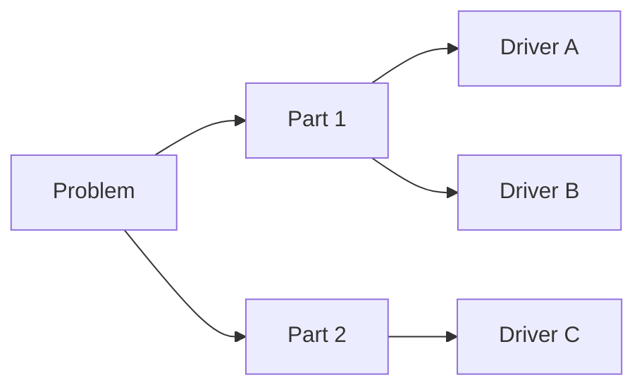

# Frame

Turn a vague request into two things: a problem statement precise enough to test, and a tree that says exactly what needs to be looked at.

First of five stages: **frame** → `analyze` → `narrate` → `decide` → `plan`, then back to frame with what execution taught.

The method is the same for a company, a codebase, a research question or a personal choice. Take the vocabulary and the examples from the user's domain, not from this file.

Respond in the user's language.

## Flow

1. Collect the minimum facts: context, goal, obstacle, who decides, deadline. For a personal problem the decider is the user. Proceed with what is given and list the gaps as open points. Stop to ask first, with at most two or three questions, only when the goal or the object of the problem cannot be inferred.
2. Pick one way to define the problem (table below) and write the statement.
3. Check the statement.
4. Pick a way to break it down and build the tree, 2 to 4 levels deep.
5. Check the tree.
6. Deliver the statement, the tree and where to start, scaled to the problem (see "What to deliver").

## Define

### Which definition to use

| Situation | Use |
| --- | --- |
| Something quick, or the problem will open a document or a presentation | **SCQ** |
| A sharp question with the goal and the obstacle spelled out | **Quest** |
| A serious problem where decider, constraints and success criteria need agreement before work starts | **Definition sheet** |

Use one by default. Combine them only when the user asks, or when the lack of agreement on who decides and what counts as success is part of the problem. Every extra framework makes the answer longer without changing what the user does next.

### Target and deadline

A statement needs a target and a deadline to be testable, but both belong to the user and to whoever decides. If they were not given, do not make up a number. Derive one from the data when there is a natural reference ("back to last year's level"), or leave a slot to fill in: "reduce to [X] by [date]". An invented number, even when flagged as an assumption, tends to become a commitment nobody made.

When the domain has no natural metric, as in many personal problems, use an observable condition ("have chosen between staying and moving, and know the first step") and add a date only if the user has one.

### SCQ: Situation, Complication, Question

Situation, complication and question come from Barbara Minto, *The Pyramid Principle*; the statement line is an addition made here.

- **Situation**: the context everyone needs to start from the same place. Facts nobody disputes.
- **Complication**: what changed or threatens the situation, and why it calls for action now. Put a number on it whenever possible.
- **Question**: the question that follows from the complication. Its answer will be the solution.
- **Statement**: the question turned into an outcome, with a measurable target and a deadline.

Example:

- S: A support team answers every ticket within one business day and has done so for two years.
- C: Over the last quarter, median first response went from 6 to 19 hours while ticket volume grew only 10%.
- Q: How does the team get back to answering within the day?
- Statement: bring median first response back to 6 hours by [date].

### Quest: Hero, Treasure, Dragon, Quest

From Arnaud Chevallier and Albrecht Enders, *Solvable*.

- **Hero**: the protagonist, who owns the problem.
- **Treasure**: what the hero wants to reach.
- **Dragon**: the single main obstacle between hero and treasure. With several dragons, pick the heaviest or open separate quests.
- **Quest**: the central question, in the form "How should [hero] get [treasure], given [dragon]?"

Example: How should the maintainers cut the test suite from 40 to 10 minutes, given that most of the time goes to tests that need a real database?

The dragon is an obstacle, not a solution in disguise. "Given that we have no cache" already assumes the answer is a cache.

### Definition sheet

Adapted from the problem definition worksheet in Charles Conn and Robert McLean, *Bulletproof Problem Solving*. Fill in:

- **Problem**: what we are trying to solve.
- **Decider**: who has to decide or act. For a personal problem this is the user; skip the field.
- **Success**: how the decider will know the problem is solved.
- **Pressures**: what worries or pushes the decider.
- **Deadline**: when the answer is needed.
- **Off limits**: what cannot be touched or considered.
- **Precision**: whether an order of magnitude is enough or an exact figure is needed.

### Checking the statement

A good statement:

- is about an outcome, not an activity;
- is specific and measurable;
- has a deadline;
- respects the decider's constraints;
- leaves room for more than one answer, so it does not contain the solution;
- addresses the whole problem, not one corner of it.

When it is unclear whether the statement describes a cause or only a symptom, ask "why?" a few times, until the answer is a cause someone can act on, before going on.

This check is for revising the sentence. If an item fails, fix the statement. The check does not become a section of the answer.

## Break down

### Which breakdown to use

| Situation | Use | Direction |
| --- | --- | --- |
| The problem has a known logical or arithmetic structure (total time = queue time + work time) | **Driver tree** | top down |
| There are many loose causes or ideas (a brainstorm, interviews) with no obvious structure | **Grouping** | bottom up |
| There are strong suspicions about the cause and testing them is faster | **Hypothesis tree** | hypothesis first |

### Driver tree

1. Put the problem at the root.
2. Split it into parts that do not overlap. Prefer splits that add up or multiply out to the parent (response time = time waiting in queue + time being worked; output = people × hours × rate).
3. Open each part into what drives it.
4. Stop when a branch is something that can be measured or acted on. Two to four levels is usually manageable.

Example, response time for support tickets:

- Time waiting in queue → incoming volume, triage rules, staffing by time of day
- Time being worked → ticket complexity, tooling, handoffs between teams
- Time waiting on the customer → clarity of the first reply, follow-up reminders

### Grouping

1. List everything (causes, ideas, components) without filtering.
2. Group items by what they have in common.
3. Groups become the main branches; items become the drivers.
4. Optionally, sharpen the problem statement in light of the structure that emerged.

Test: every item fits in exactly one group, and there is no large "other" group left over.

### Hypothesis tree

1. Write the likely causes as testable hypotheses. Each must be possible to prove false.
2. For each one, say which fact would confirm or kill it and what data that takes.
3. Order the hypotheses by how likely they are and how cheap they are to test. The testing happens in `analyze`; killed hypotheses leave the tree, but keep a record that they were tested.

Format: claim plus expected evidence. "Response time rose because the new triage form sends everything to one queue → expected: the rise is concentrated in tickets created after the form changed."

### Checking the tree

The standard is MECE, from Minto: mutually exclusive, collectively exhaustive.

- Branches do not overlap.
- Together, the branches cover the whole problem.
- Sibling branches sit at the same level of abstraction.
- Leaves can be measured or acted on.

Like the statement check, this is for adjusting the tree. In the answer, mention only what stayed ambiguous and the user has to settle, such as an item that could sit under two branches. One line is enough.

## What to deliver

The user wants the result, not the method. The frameworks and checks above are for thinking and revising. The answer has:

1. **The problem** in one or two sentences, in the user's words.
2. **The breakdown** as an indented list. If the user wants a picture, draw it with Mermaid:

3. **What to look at, in order**: for each branch worth checking, the question to answer and the data or fact that answers it. Start with the branch most likely to explain the problem or cheapest to check, and say what the user can do today.
4. **Open points** the user has to confirm, one line each. From the definition sheet, only the fields that depend on the user (decider, off limits, deadline) go here.

Keep the method's vocabulary out of the answer. "Quest", "SCQ", "MECE", "statement", "split rule", "driver", "hypothesis tree" and "analysis plan" are names for thinking; the user gets the content under ordinary headings, or under none.

### Scale to the problem

The four parts above suit a problem inside an organization that someone will investigate with data. Shrink them when the problem is smaller or personal.

For a personal problem ("I feel stuck", "I don't know whether to move"), write the way a thoughtful friend who thinks clearly would talk, in prose, with no table and no tree notation:

- say what the real question seems to be, which is often not the one asked;
- pull apart the things that are tangled together (being bored, being underpaid and being afraid are three problems with three different fixes);
- for each, say what would settle it and the one cheap thing to find out or try first.

The structure still does the work; it just does not show. A person who brings a worry and receives a consulting document feels processed, not helped.

Left out of the answer: sections for the statement check, the tree check or the full definition sheet, and explanations of how each framework works. The shorter the answer, the sooner it turns into work. Cut what does not change the user's next step.

Prose, lists, tables and headings follow the user's preferences when they have any; the layout above is the default when they do not. If the user asks for a slide or a document, use whatever presentation or document skill the environment has, with this structure as content.
